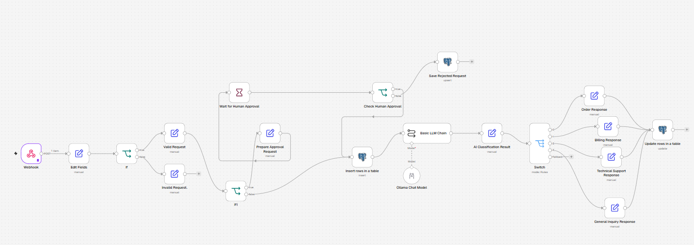

# FlowForge AI — Intelligent Business Automation Platform

FlowForge AI is an AI-powered business automation platform that automates customer request processing using **FastAPI, n8n, Ollama (Llama 3.2), PostgreSQL, and Docker**.

The platform combines REST API integration, workflow orchestration, local LLM classification, department-based routing, database persistence, and human-in-the-loop approval.

## Key Features

- **REST API:** Submit customer requests through FastAPI.
- **Workflow Automation:** Orchestrate business processes using n8n.
- **AI Classification:** Classify customer requests using Ollama and Llama 3.2.
- **Intelligent Routing:** Route requests to billing, order, technical support, or general inquiry.
- **Human Approval:** Pause high-priority requests for approval or rejection.
- **Database Integration:** Store customer requests and update processing statuses in PostgreSQL.
- **API Security:** Protect request submission using API-key authentication.
- **Webhook Security:** Authenticate requests forwarded from FastAPI to n8n.
- **Automated Testing:** Validate API functionality and security using pytest.
- **Containerization:** Run the FastAPI service using Docker.

## Technology Stack

| Component | Technology |
|---|---|
| Backend | Python 3.13, FastAPI |
| Workflow orchestration | n8n |
| Large language model | Llama 3.2 |
| LLM runtime | Ollama |
| Database | PostgreSQL |
| Containerization | Docker, Docker Compose |
| Testing | pytest, httpx |
| API validation | Pydantic |

## System Architecture

```text
Customer Request
       |
       v
FastAPI REST API
       |
       v
API Key Authentication
       |
       v
Authenticated n8n Webhook
       |
       v
Request Validation
       |
       v
Priority Evaluation
       |
       +---- High Priority
       |          |
       |          v
       |    Human Approval
       |          |
       |      +---+---+
       |      |       |
       |   Approve  Reject
       |      |       |
       |      |       v
       |      |   Save Rejection
       |      v
       +---- Continue
              |
              v
       PostgreSQL Storage
              |
              v
       Ollama / Llama 3.2
              |
              v
       AI Classification
              |
              v
       Department Routing
              |
              v
       PostgreSQL Status Update
```

## n8n Workflow Architecture

FlowForge AI uses n8n to orchestrate customer request processing, AI classification, human approval, and database operations.



### How the Workflow Works

1. **Customer Request:** FastAPI receives and validates incoming requests using API-key authentication.
2. **Workflow Trigger:** FastAPI forwards the request to the authenticated n8n webhook.
3. **Priority Check:** n8n evaluates whether the request requires human approval.
4. **Human Approval:** High-priority requests wait for an approval or rejection decision.
5. **Database Storage:** Approved and normal-priority requests are stored in PostgreSQL.
6. **AI Classification:** Ollama with Llama 3.2 classifies the customer request.
7. **Department Routing:** n8n routes requests to Order, Billing, Technical Support, or General Inquiry.
8. **Status Update:** PostgreSQL records the processing result. Rejected requests follow a separate rejection path.

### Business Value

FlowForge AI demonstrates how organizations can combine workflow automation, local LLMs, API integration, and human oversight to reduce repetitive customer request handling.

```

## API Endpoints

| Method | Endpoint | Description |
|---|---|---|
| GET | `/` | Application information |
| GET | `/health` | Application health check |
| POST | `/requests` | Submit a customer request |

The request submission endpoint requires an `X-API-Key` header.

## Security

FlowForge AI implements several security controls:

- API-key authentication for request submission.
- Shared-secret authentication between FastAPI and the n8n webhook.
- Input validation using Pydantic.
- Basic authentication configured for the human approval form.
- Environment-based configuration for sensitive values.
- Git exclusion of local `.env` files and sensitive workflow exports.

These controls are designed for the current local prototype. Additional security hardening is required before public production deployment.

## Workflow

The n8n workflow is available in:

`workflows/flowforge-workflow.json`

Import this JSON file into n8n, configure the required credentials, and replace the placeholder webhook secret with a securely configured value.

The workflow includes 20 nodes covering request intake, validation, approval, database operations, AI classification, and routing.

## Local Setup

### Prerequisites

- Python 3.13
- Docker Desktop
- n8n
- PostgreSQL
- Ollama with the `llama3.2` model

### Installation

Clone the repository and enter the project directory.

Create a Python virtual environment and install the dependencies:

```bash
python -m venv .venv
```

On Windows PowerShell:

```powershell
.\.venv\Scripts\Activate.ps1
pip install -r requirements.txt
```

Configure the required environment variables, including:

- `FLOWFORGE_API_KEY`
- `N8N_WEBHOOK_SECRET`
- `N8N_WEBHOOK_URL`

Use local secret values and never commit the `.env` file.

Ensure the n8n webhook, PostgreSQL database, and Ollama service are configured and reachable.

Start the API locally:

```bash
uvicorn app.main:app --reload
```

Interactive API documentation is available at `/docs`.

The included Docker Compose configuration can also run the API service, provided its required external services and Docker network are configured.

## Automated Testing

Run:

```bash
python -m pytest -v
```

**Latest verified result: 10 tests passed.**

The automated suite covers API behavior and security-related checks.

## Project Status

The core workflow has been implemented and tested locally, including:

- FastAPI request submission
- n8n webhook integration
- Ollama-based AI classification
- Department routing
- PostgreSQL persistence
- Human approval and rejection workflow
- Docker-based API execution
- Automated API and security testing

The final Basic Auth approval challenge and complete standalone Docker Compose deployment remain to be verified.

## Future Improvements

- Centralized workflow monitoring and observability
- Expanded automated integration testing
- Role-based approval authorization
- Cloud deployment
- Production security hardening

## Project Purpose

FlowForge AI demonstrates practical skills in **AI automation engineering, LLM integration, workflow orchestration, backend development, database integration, and human-in-the-loop business processes**.

It is designed as a portfolio project showcasing how AI can be integrated into real-world business automation workflows.
